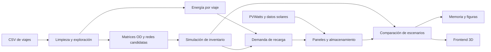

# Plan del Proyecto 3

**Planificación y optimización de un sistema de patinetes compartidos con estaciones de anclaje y recarga fotovoltaica en Roma.**

| Sección | Decisión que prepara |
| --- | --- |
| [1. Objetivo y alcance](#1-objetivo-y-alcance) | Qué preguntas responde el proyecto y qué entregamos |
| [2. Arquitectura y reproducción](#2-arquitectura-y-reproducción) | Cómo se regeneran y conectan los resultados |
| [3. Datos y exploración](#3-datos-y-exploración) | Qué viajes entran en el análisis, qué parámetros fija la exploración (fase 0) y cómo se valida la red |
| [4. Movilidad y flota](#4-movilidad-y-flota) | Dónde ubicar estaciones y cuántos anclajes y patinetes instalar |
| [5. Consumo](#5-consumo) | Cuánta energía necesita cada viaje y dónde se repone |
| [6. Estaciones de recarga](#6-estaciones-de-recarga) | Qué potencia, superficie solar y almacenamiento necesita una estación |
| [7. Experimentos integrados](#7-experimentos-integrados) | Las doce mejoras acordadas, su esfuerzo y la evidencia que debe producir cada una |
| [8. Demo 3D para la defensa](#8-demo-3d-para-la-defensa) | Cómo enseñar un resultado y explorar sus consecuencias en directo |
| [9. Memoria y entrega](#9-memoria-y-entrega) | Qué evidencias entran en los entregables |
| [10. Calendario y reparto](#10-calendario-y-reparto) | En qué orden se construye y quién revisa cada bloque |
| [11. Riesgos y criterios de cierre](#11-riesgos-y-criterios-de-cierre) | Cómo detectar problemas y verificar el trabajo final |

## 1. Objetivo y alcance

Estudiamos cómo cambiaría el servicio si los viajes observados con Helbiz en Roma tuvieran que empezar y terminar en estaciones fijas. Usamos los orígenes, destinos y horas de febrero de 2021 como demanda de referencia. Las estaciones, la asignación de los viajes y la operación que se muestran en la demo son resultados de una simulación. Las preferencias de los usuarios y la viabilidad de los emplazamientos se tratan como hipótesis de diseño.

1. **Movilidad (60 %).** Generar matrices origen–destino, comparar redes candidatas y recomendar el número y la ubicación de estaciones, sus anclajes y el tamaño de la flota. Mostrar cuánto acceso o servicio se gana por cada incremento de infraestructura.
2. **Consumo (10 %).** Estimar Wh por viaje y agregarlos por patinete, flota y estación de destino. Contrastar los 13,5 Wh/km del enunciado con un modelo físico sencillo y explicar qué cambia al variar sus supuestos.
3. **Recarga (20 %).** Calcular perfiles de demanda para todas las estaciones. Dimensionar los paneles y la batería de apoyo de una estación concreta, con curvas de potencia y un balance energético verificable.
4. **Conclusiones (10 %).** Justificar el diseño con indicadores, exponer sus límites y entregar el código que reproduce las cifras de la memoria. [Enunciado y formato de entrega](enunciado.md)

**Objetivo de la defensa.** Extender el mapa 3D existente para comparar la operación normal, el cierre de una estación en hora punta y la respuesta de una red mejorada con el mismo presupuesto de infraestructura. La maqueta permitirá inspeccionar los anclajes, paneles y almacenamiento de la estación dimensionada.

**Alcance acordado por el equipo.** Implementar las doce mejoras de la sección 7, incluida la carga inteligente con reserva de patinetes listos. Los requisitos y pesos de evaluación son los del enunciado. [Experimentos integrados](#7-experimentos-integrados) · [Seguimiento de tareas](TAREAS.md)

## 2. Arquitectura y reproducción

### Estructura y orden de ejecución

| Ubicación | Responsabilidad |
| --- | --- |
| [datos/brutos/](../datos/brutos/README.md) | CSV original con su huella SHA-256. |
| [datos/externos/](../datos/externos/README.md) | Respuestas de fuentes externas y metadatos. Registrar fuente, fecha de descarga, parámetros, cobertura, unidades, licencia cuando corresponda y hash. |
| [datos/procesados/](../datos/procesados/README.md) | Viajes normalizados, catálogos geográficos, asignaciones y tablas intermedias compartidas. |
| `comun/` y `config.yaml` | Lectura, distancias, unidades, configuración de los escenarios y utilidades que usan varios módulos. |
| [exploracion/](../exploracion/README.md) | Notebooks de limpieza y exploración de la fase 0. Generan `viajes_limpios.parquet` y las tablas y figuras que fijan los parámetros de las fases siguientes. |
| [movilidad/](../movilidad/README.md), [consumo/](../consumo/README.md) y [estacion_recarga/](../estacion_recarga/README.md) | Cálculos y simulaciones de cada fase. |
| [resultados/](../resultados/README.md) | Indicadores, comparativas, series horarias, mapas y gráficas. |
| `frontend/` | Web de resultados en GitHub Pages con gráficas por fase y el mapa 3D de Roma en `#/mapa`. Los notebooks exportan sus datos y el simulador aportará los escenarios que comparará la demo. |
| [memoria/](../memoria/README.md) y [presentacion/](../presentacion/README.md) | Memoria reproducible, diapositivas y recursos de la defensa. |

- Fijar el entorno de Python 3.12 y sus dependencias. Empezar con pandas, NumPy, las herramientas geográficas necesarias y Matplotlib. Incorporar y fijar el solver de MILP al entrar en la comparación formal. Verificar su instalación y un problema pequeño en los dos equipos.
- Centralizar en `config.yaml` los umbrales de limpieza, radios, candidatos, presupuestos, semillas, hipótesis físicas, eficiencias y entradas de cada escenario. Registrar en cada ejecución la configuración, la versión del código, los hashes de entrada y el estado del solver.
- Hacer cada análisis en un notebook con una celda por análisis: antes, el título, qué queremos ver y por qué importa; después, las conclusiones. El comando maestro `python ejecutar_todo.py` ejecuta los notebooks en orden y regenera tablas, figuras y datos de la web desde el CSV y las fuentes externas guardadas. La descarga o actualización de fuentes será un paso explícito. Guardar solicitudes sin claves y sacar el secreto de PVWatts del código y del frontend.
- Usar `trip_id` estable derivado del CSV para los cruces entre fases. Mantener `idS` para estadísticas observadas, `station_id` para la identidad geográfica y `scenario_id` para la configuración de una simulación. Usar geometrías WGS84 para intercambio y metros para calcular distancias. Documentar la proyección cuando se usen operadores planos.
- Definir desde el principio la granularidad de las salidas. Eventos de movilidad con hora exacta, estados de estación cada 15 minutos y balance energético por hora. Diferenciar estados al cierre del intervalo, como el inventario, de sumas durante el intervalo, como los viajes completados o los kWh.

### Contratos entre fases

| Salida prevista | Campos o controles decisivos | Consumidor |
| --- | --- | --- |
| `viajes_limpios.parquet` | `trip_id`, `idS`, `tsO` y `tsD` en `Europe/Rome`, `lonO`, `latO`, `lonD`, `latD`, `dis_m`, `tt_s`, `vel_kmh`, `price_eur`, `periodo` (`ajuste` o `reservada`), `motivo` con todas las marcas separadas por `;` y `elegible` | Exploración, movilidad y consumo |
| Catálogo de estaciones por red | `station_id`, coordenadas, área de cobertura, capacidad en anclajes y stock inicial | Simulador y frontend |
| Asignaciones y eventos | `scenario_id`, `trip_id`, estaciones asignadas, distancias, estado y causa primaria de rechazo, salida y llegada efectivas | Recarga, indicadores y frontend |
| Consumo por viaje (`T43_energia_viaje.parquet`) y llegadas con energía (`T44_entrada_recarga.parquet`) | `trip_id`, `idS`, `red`, `periodo`, `tsD`, `estacion_destino`, `energia_wh_a` y `energia_wh_b`; clave `(red, trip_id)` y sumas conciliadas por viaje, patinete, flota y estación | Recarga y balance de flota |
| Series de recarga y energía | Estación, principio y duración del intervalo, demanda, generación, batería, red y demanda pendiente o sin servir | Dimensionado, memoria y demo |
| Exportación de demo | `run_id`, esquema, escenarios, geometrías, series y resúmenes obtenidos de las tablas anteriores | Frontend |

Un viaje aceptado conserva el mismo identificador hasta su llegada y su recarga. Las uniones entre tablas se verifican por clave y cobertura. Los valores ausentes conservan su significado, especialmente un tiempo sin datos frente a un tiempo con actividad cero.

## 3. Datos y exploración

Esta sección, junto con el entorno de la sección 2, forma la **fase 0**, que se cierra en el seguimiento del 23/11. Su objetivo es dejar los viajes limpios y fijar con datos los parámetros que usan las fases siguientes, en lugar de suponerlos.

### Limpieza auditable

`trip_id` es la posición de la fila en el CSV original, empezando en 0. Ningún viaje se borra: los no válidos quedan con `elegible = False` y sus marcas en `motivo`. `periodo` se asigna por la hora de salida.

1. Verificar la huella del CSV y el esquema. Parsear `tsO` y `tsD` en `Europe/Rome`, comprobar que `tsD − tsO` concuerda con `tt` y validar la identidad `vel = 3,6 × dis / tt` con la tolerancia numérica apropiada.
2. Marcar en `motivo` las anomalías estructurales y los viajes sospechosos. Evaluar con histogramas los criterios iniciales del plan anterior, como duración inferior a 60 s, distancia inferior a 100 m, velocidad superior a 25 km/h y duración superior a 2 h. Revisar coordenadas y relaciones entre distancia, duración y precio.
3. Conservar las marcas simultáneas por viaje. Producir un recuento por motivo y una tabla secuencial donde cada viaje excluido se cuenta una vez. Comparar una limpieza principal y una menos restrictiva en el recuento, la concentración espacial y los indicadores del caso elegido. Revisar los extremos del periodo de ajuste antes de fijar los umbrales y aplicar los mismos criterios a la semana reservada.
4. Detectar solapes temporales por `idS` y saltos entre viajes consecutivos. Explicar cuántos son compatibles con una recolocación y cuánto cambia la estimación según el umbral. Los saltos son indicios, con posibles efectos de GPS y actividad fuera de la muestra. [Diccionario y exploración inicial](datos.md)

### Exploración espacial y temporal

- Generar series diarias, un mapa de calor de hora y día de la semana, distribuciones de recorrido y mapas separados de orígenes y destinos. Añadir el saldo neto de cada zona para localizar dónde podría acumularse flota.
- Usar H3 como rejilla común, con resolución 8 como punto de partida, y contrastar los patrones con límites administrativos disponibles. Documentar puntos que caen fuera de ambas zonificaciones y áreas con poco volumen.
- Usar del 1 al 21 de febrero para seleccionar candidatos y ajustar parámetros espaciales y de demanda. Reservar del 22 al 28 para evaluar con los mismos criterios y sin retocar la red al ver el resultado. Definir la pertenencia de cada viaje por su hora de salida y documentar las llegadas que cruzan el corte. Si la simulación arrastra inventario entre periodos, registrar el estado inicial del día 22 y aplicar el mismo procedimiento a las alternativas.
- Explorar meteorología y tarifa únicamente si aportan una comparación concreta. Presentar asociaciones por día con su tamaño muestral y supuestos. La demanda cubierta refleja los viajes registrados por Helbiz durante ese mes.

### Exploración orientada a decisiones

Cada pregunta de la exploración alimenta una decisión de las fases siguientes. Una figura que no responde a ninguna no entra en la memoria. Las cifras que fijan parámetros se calculan sobre el periodo de ajuste; la semana reservada solo se describe para compararla.

| Pregunta | Qué se mide | Decisión que alimenta | Tarea |
| --- | --- | --- | --- |
| ¿Hay solapes y recolocaciones? | Viajes solapados del mismo `idS` y saltos entre viajes consecutivos | Si el piloto ya rebalanceaba y qué traslados conviene simular | T11 |
| ¿Cuándo se viaja? | Serie diaria, hora × día de la semana, laborable frente a fin de semana | Franjas horarias y tipos de día de las matrices OD y del simulador | T12 |
| ¿Cuántos patinetes circulan a la vez? | Viajes en curso minuto a minuto y su máximo | Cota inferior de la flota frente a los 2 331 `idS` observados | T12 |
| ¿Dónde empiezan y acaban los viajes? | Orígenes y destinos por celda H3 en resoluciones 8 y 9 | Resolución de la rejilla y zona donde buscar candidatos | T13 |
| ¿Está concentrada la demanda? | Celdas necesarias para reunir el 50, 80, 90 y 95 % de los extremos | Rango de número de estaciones del barrido | T13 |
| ¿Dónde se acumula la flota? | Saldo orígenes − destinos por celda, franja y día | Necesidad de rebalanceo y estaciones que piden más anclajes | T14 |
| ¿Cómo son los recorridos? | `dis_m`, `tt_s`, `vel_kmh`, rodeo frente a línea recta y viajes circulares | Radios de acceso del barrido y demanda que dejaría de tener sentido con estaciones | T15 |
| ¿Cuánta energía mueve cada patinete? | km y Wh por viaje, patinete y día con 13,5 Wh/km | Frecuencia de recarga y orden de magnitud de la demanda por estación | T16 |
| ¿Hay días anómalos? | Viajes diarios frente a lluvia y temperatura | Si se excluye algún día y si la semana reservada es comparable | T17 |
| ¿Qué importe representa la demanda observada? | Tarifa por desbloqueo y minuto, importe elegible y diferencia con el bruto | Comparar el importe nominal de los viajes atendidos entre escenarios con la misma tarifa | T18 |

**Conclusiones de la fase 0.** `docs/conclusiones_eda.md` recoge, para cada decisión, el valor propuesto, la tabla o figura que lo justifica, el periodo sobre el que se ha calculado y lo que cambia en este plan. Es el documento que se lleva al seguimiento del 23/11. Los parámetros acordados pasan a `config.yaml`.

**Evidencia de cierre.** Regenerar el inventario de calidad, el número de viajes elegibles, los conteos por periodo y las figuras de exploración desde el comando principal. Fijar y conservar el conjunto utilizado en cada experimento.

## 4. Movilidad y flota

### Matrices origen–destino

- Construir matrices por H3 y zonas administrativas para todo el periodo y por franja horaria y tipo de día. Agregar por hora de salida y conservar la hora de llegada para el simulador.
- Tras elegir una red, generar la matriz estación → estación de la demanda asignable y la de los viajes atendidos bajo capacidad. Incluir recuentos de viajes fuera de cobertura. La suma de cada matriz se concilia con su universo, filtros y tratamiento de puntos no asignados.
- Reportar pares con más viajes, proporción intrazonal y asimetría `M − Mᵀ`. Usar líneas de deseo ponderadas y una matriz de calor. En los mapas, etiquetar las líneas como flujos agregados entre extremos.

### Candidatos y optimización

Formar candidatos a partir de celdas con demanda en el periodo de ajuste. Levantar un catálogo de coordenadas y comprobar sobre el mapa casos sensibles como extremos junto al río, vías de acceso restringido y concentraciones de candidatos muy próximas. Anotar el estado de verificación del emplazamiento. Los centros de celda dan candidatos analíticos y requieren una comprobación urbana antes de interpretar el diseño como instalable.

T24 deja el [catálogo compartido de candidatos](../resultados/tablas/movilidad/T24_candidatos.csv). T25 guarda las [redes de referencia](../resultados/tablas/movilidad/T25_redes.csv) y su [barrido en el ajuste](../resultados/tablas/movilidad/T25_barrido.csv). Las evaluaciones posteriores pueden reutilizar los mismos identificadores, radios y métricas.

| Método | Decisión que permite tomar | Evidencia |
| --- | --- | --- |
| K-medoids sobre puntos o celdas ponderadas | Obtener una referencia para varios números de estaciones. K-means con ajuste a candidatos es una segunda referencia viable. | Distancias de ambos extremos y número efectivo de emplazamientos distintos. |
| Cobertura de conjuntos con cobertura parcial (variante de LSCP) | Minimizar el número de estaciones para un objetivo dado de viajes cubiertos. | Solución factible, objetivo de cobertura, radio y brecha del solver si está disponible. |
| p-mediana | Minimizar la distancia agregada de acceso y salida para un presupuesto fijo de estaciones. | Distancias media y P90 a la estación en origen y destino. |
| Cobertura máxima (MCLP) | Maximizar el número de viajes con ambos extremos cubiertos bajo un presupuesto fijo. | Curva cobertura frente a estaciones y lista de viajes excluidos. |

- Comparar con el mismo conjunto de candidatos, viajes, radios y métrica de distancia. Usar los radios de `config.yaml` (200, 250 y 300 m, con 400 m como sensibilidad). Calcular distancias geográficas para el barrido y contrastar las redes finalistas con un grafo peatonal en dos sectores con barreras.
- Un viaje está **cubierto** si tanto el origen como el destino tienen una estación accesible dentro del radio. Medir también cobertura de cada extremo y cuantiles de distancia para revelar dónde se pierde servicio. Los cuantiles indican explícitamente si se calculan sobre todos los viajes o sobre el subconjunto cubierto.
- Mostrar un frente de Pareto con estaciones, cobertura y distancia de acceso. Tomar hasta tres redes finalistas que representen compromisos distintos y pasar cada una por la misma simulación de flota. Registrar método, presupuesto, radio, tiempo de cómputo y calidad conocida de la solución.
- Elegir la propuesta con un criterio fijado sobre el periodo de ajuste, por ejemplo el menor número de estaciones que cumpla el nivel de servicio y acceso acordado. Mostrar también el resultado en la semana reservada y la alternativa inmediatamente más económica en infraestructura.
- En T26 y T27, comprobar los recuentos en los viajes originales y auditar la brecha con una relajación OD compacta. Publicar el intervalo entre cota y solución en las unidades de cada objetivo. En T28, mostrar las tres finalistas y permitir revisar objetivos de cobertura sobre el barrido del ajuste.
- En T29, documentar rutas comparables, casos sin par medible, pérdidas solo en el origen, solo en el destino o en ambos, y sensibilidad al umbral con la red fija. En T30, publicar cobertura y volumen de cada día y comparar los dos periodos por tipo de día y franja. Separar cambio en el peso de las franjas y cambio de cobertura dentro de ellas.

### Capacidad e inventario

1. **Referencia de capacidad.** Para una asignación fija sin rechazos ni rebalanceo, calcular el mínimo de la serie acumulada de llegadas menos salidas por estación. El stock inicial mínimo es el valor necesario para que el saldo total nunca sea negativo. El máximo del inventario resultante da una referencia de anclajes para esa secuencia. Definir el orden de los eventos empatados y explicar el supuesto de inventario inicial.
2. **Simulación con restricciones.** Procesar llegadas y recogidas en orden temporal. Fijar que las llegadas de viajes ya iniciados se procesan antes que las nuevas solicitudes con la misma hora. Verificar un patinete disponible en el origen y reservar un anclaje de destino cuando se acepta un viaje. En un viaje circular cuenta el hueco liberado por su salida. La reserva anticipada es una política conservadora que hace explícito el compromiso de devolución.
3. **Asignación y alternativas.** Probar primero la estación candidata más cercana en cada extremo. Cuando falte inventario o hueco, permitir desvío a otra estación dentro del radio del escenario. Usar el tiempo de viaje observado como aproximación y guardar la distancia adicional y cada causa de rechazo. Los viajes rechazados quedan fuera del inventario y de la recarga simulados.
4. **Dimensionado.** Barrer tamaños de flota y anclajes por estación. Comparar ajustes de stock inicial y los límites de 0, 100 y 220 movimientos nocturnos de `config.yaml`. Registrar la distancia, el tiempo y los vehículos en tránsito durante cada recolocación.
5. **Indicadores.** Mostrar viajes completados / solicitudes válidas, rechazos por cobertura, estación inactiva, falta de vehículo o anclaje y, si se activa, batería. Reportar salidas y devoluciones por estación, viajes por patinete y día, horas de uso sobre horas disponibles y distribución de ocupación. Explicar la diferencia entre la flota simulada y los 2 331 identificadores observados en el mes.

**Evidencia de cierre.** Comprobar con casos pequeños que se conserva el total de patinetes entre estaciones y tránsito, que la ocupación más reservas respeta la capacidad y que cada solicitud tiene un resultado único. Entregar una tabla por estación con coordenadas, stock inicial, anclajes y utilización, más la curva de servicio frente a tamaño de flota.

La fase conserva la red y la política que alcanzan los objetivos de cobertura y servicio del ajuste con los recursos adoptados. Las variantes territoriales y de redundancia se evalúan con los mismos totales de patinetes y anclajes. La energía por viaje del Modelo A alimenta el contraste de batería y la demanda equivalente por estación. [Cierre y evidencia](conclusiones_eda.md#cierre-de-la-fase-1)

## 5. Consumo

### Modelo de referencia

Calcular la energía de tracción de cada viaje como `E_wh = 13,5 × dis_m / 1 000`. Interpretar `dis` como la distancia recorrida registrada y reservar la distancia entre coordenadas para geometría y comprobaciones. Como caso de control, un viaje de 2 km debe dar 27 Wh.

- Calcular por viaje el porcentaje de una batería nominal de 576 Wh y marcar estimaciones incompatibles con una sola carga. Agregar por patinete y día, flota y estación de destino. Los ciclos completos equivalentes son energía acumulada dividida por 576 Wh.
- Distinguir el **consumo de los viajes válidos observados** del **consumo de los viajes atendidos por una red simulada**. El primero sirve para describir la muestra. El segundo se enlaza a la estación de devolución y alimenta el cálculo de demanda de recarga. Documentar los viajes sin destino asignado para conciliar las dos vistas.
- Medir por cada red el total y la distribución de energía a reponer por estación. Una red con igual consumo global puede concentrar la recarga en menos emplazamientos y cambiar los picos.

### Modelo físico y sensibilidad

1. Calcular el trabajo de rodadura y resistencia aerodinámica con la distancia registrada, la velocidad media y parámetros referenciados de masa, rodadura, densidad del aire y área aerodinámica efectiva.
2. Incluir desnivel y arranques si hay datos o hipótesis trazables. Un modelo de elevaciones puede aproximar el desnivel neto entre extremos. Documentar la resolución y la incertidumbre de elevación. La pendiente acumulada, las frenadas y el perfil de aceleración se desconocen para los viajes individuales.
3. Pasar del trabajo mecánico a Wh de batería con eficiencias explícitas y una hipótesis sobre regeneración. Usar energía neta de descarga no negativa en la referencia sin regeneración, calculada a partir del esfuerzo de propulsión necesario por tramo o de forma aproximada por viaje.
4. Contrastar la intensidad energética agregada `ΣE_wh / Σdist_km` con 13,5 Wh/km. Si se aplica una calibración de escala, mostrar el valor inicial, el ajustado y el efecto sobre la distribución por estación. El dato de referencia permite regular la escala de un modelo, mientras que el consumo real por viaje requeriría telemetría de batería.
5. Recalcular un escenario bajo, central y alto variando los parámetros dominantes. Comparar si cambia la estación crítica, su pico de potencia o el tamaño de batería recomendado. Priorizar las incertidumbres que alteren una decisión.

**Evidencia de cierre.** Conciliar las sumas por viaje, flota y estación sobre los mismos conjuntos. Entregar una tabla por viaje y un contraste de modelos con el cambio observado sobre el dimensionado.

La fase deja el Modelo A (13,5 Wh/km) como demanda base de recarga y el Modelo B calibrado como sensibilidad por estación. El factor de escala, 1,8593, se fija en el ajuste y da 13,54 Wh/km en la semana reservada. Con la red elegida se reponen 16,64 kWh/día en el ajuste y 18,76 kWh/día en la semana reservada, y las sumas por viaje, patinete, flota y estación cuadran. Con carga en cada anclaje y reserva del 20 %, ningún patinete se queda sin batería. Queda la sensibilidad de T46. [Cierre y evidencia](conclusiones_eda.md#cierre-de-consumo-t40t45)

## 6. Estaciones de recarga

### De llegadas a potencia demandada

- Usar las llegadas atendidas de la simulación y el consumo estimado. En el modelo base, cada llegada genera una solicitud de reposición por la energía del viaje. Usar 576 Wh / 7 h ≈ 82 W como potencia media equivalente en batería y explicitar el rendimiento del cargador. La energía a la entrada es `E_viaje / η_cargador`.
- Calcular las curvas de demanda cada 15 minutos por solape real de la sesión con cada intervalo. Definir la duración de sesión con la potencia en el mismo lado en el que se calcula la energía. Sumar los kWh para obtener la serie horaria utilizada en el balance.
- Distinguir el perfil de carga inmediata ideal del perfil viable con los cargadores disponibles y el límite de potencia simultánea. Aplicar una cola con política explícita si la estación se satura. Separar energía pedida, servida, aplazada y pendiente al final del periodo. Las sesiones que crucen medianoche conservan su energía y su hora de inicio.
- Usar una simulación acoplada para evaluar disponibilidad por batería. Cada patinete simulado tiene un estado de carga. Comprobar antes de la salida que su energía supera el consumo previsto más la reserva elegida. Descontar el consumo al completar el viaje y recuperar energía solo mientras está anclado y asignado a un cargador. Una salida cancela o pausa la carga según la política simulada. El saldo viaja con el patinete en lugar de crear una recarga teórica adicional.
- Calcular para todas las estaciones energía diaria y total, pico y P95 de potencia, carga simultánea y horas con cola. Elegir en el periodo de ajuste la estación a detallar. Contrastar las candidatas con mayor energía total, mayor pico de potencia y mayor carga fuera de las horas solares. Justificar el criterio usado.

### Generación solar y tamaño físico

1. Solicitar a PVWatts v8 una serie horaria AC de referencia en las coordenadas de la estación. Conservar los parámetros de la consulta, la respuesta saneada y los metadatos de la fuente solar. Fijar inclinación, orientación, potencia nominal, pérdidas y relación DC/AC. `ac` se devuelve en W para la consulta horaria. [Documentación de PVWatts v8](https://developer.nlr.gov/docs/solar/pvwatts/v8/)
2. Situar cada intervalo en el reloj de Roma distinguiendo la convención temporal de la fuente y la del CSV. Verificar las 672 horas de febrero y la alineación diurna. PVWatts aporta un perfil de año meteorológico típico para el escenario de diseño. Como ampliación, contrastar con una serie de febrero de 2021 estimada por PVGIS, cuya base de radiación y convención horaria deben quedar documentadas. [API de PVGIS](https://joint-research-centre.ec.europa.eu/photovoltaic-geographical-information-system-pvgis/using-pvgis-5/api-non-interactive-service_en)
3. Dimensionar una marquesina conceptual con un módulo de referencia que tenga potencia y dimensiones documentadas. Filtrar diseños por superficie utilizable y comprobar la potencia de inversor y cargadores. Si se usa escalado lineal de una salida de referencia para el barrido, volver a comprobar el diseño elegido con su configuración final. Documentar hipótesis de sombras y las comprobaciones urbanas pendientes.

### Balance y decisión

Modelar todos los flujos en el lado AC con intervalos de una hora y energía en kWh. Para cada intervalo, aplicar la generación directa a la demanda, cargar la batería con el excedente y descargarla ante déficit. La red cubre lo que falta cuando está disponible. Un escenario aislado registra explícitamente demanda sin servir.

- Mantener el estado de carga `B` dentro de los límites de capacidad útil, con potencias de carga y descarga máximas. Si `E_in` entra desde AC y `E_out` se entrega a AC, actualizar el estado con `B_siguiente = B + η_carga × E_in − E_out / η_descarga`. Limitar ambos flujos por la energía de batería disponible o el espacio libre, por el excedente o déficit del intervalo y por potencia × duración.
- Comparar desde el mismo estado inicial y con una atribución clara de energía. Partir del mínimo útil en la referencia o usar el mismo calentamiento para todos los diseños. Registrar el saldo final, el vertido o excedente y las pérdidas. En la referencia, cargar el almacenamiento con solar.
- Verificar el cierre de cada intervalo. La suma de producción AC, importación y descarga AC debe coincidir con la carga servida, la energía AC enviada a la batería y el excedente. La energía demandada y la servida difieren solo por la energía que se difiere o queda sin cubrir según el escenario.
- Probar `N` paneles frente a baterías nominales de 4, 8 y 12 kWh con 4, 5 y 5 kW nominales, respectivamente. Incluir referencias con red sin solar y con solar sin batería. Para varias baterías, justificar cómo se combinan potencia y capacidad. [Especificaciones del enunciado](enunciado.md#estación-de-recarga)
- Medir kWh importados, pico de importación, demanda sin cubrir, autoconsumo de producción solar, excedentes y horas de autonomía **entre las horas con demanda**. Contar como autónoma una hora activa con la carga del intervalo servida y sin importación. Informar también el porcentaje de demanda servida sin red, el saldo final y los días que pierden autonomía.
- Mostrar el frente de paneles, almacenamiento y dependencia de red. Evaluar objetivos de autonomía como 90 % y 95 % de horas activas a modo de sensibilidad. Elegir entre alternativas factibles y publicar el incremento marginal de superficie y batería necesario para el siguiente objetivo. Si se incorpora coste, separar inversión y operación y citar fecha y fuente de precios.

**Evidencia de cierre.** Probar el balance con una hora sin sol, una con excedente, una batería llena y una descarga limitada por potencia. Entregar la serie horaria, la comparación de diseños y una ficha con posición, paneles, kWp, superficie, batería útil y nominal, kW y autonomía estimada.

## 7. Experimentos integrados

Las doce mejoras forman parte de la entrega del equipo. Los rangos son horas-persona estimadas e incluyen implementación, comprobaciones y un resultado utilizable en la memoria o la defensa. La suma de los rangos es **88–152 h-persona**. El simulador, los datos y la exportación se reutilizan entre mejoras. El motor base de asignación e inventario T31–T34 tiene una estimación propia de **16–26 h-persona**. [Seguimiento de tareas](TAREAS.md)

| Mejora | Trabajo previo | Esfuerzo | Entregable y valor |
| --- | --- | ---: | --- |
| **1. Optimizar viajes completos (T26–T30)** | Candidatos T24 y referencia voraz T36 | **8–14 h** | Comparar el voraz por extremos con un modelo que maximice viajes cubiertos en origen **y** destino. Entregar la curva de cobertura y distancias con el mismo número de estaciones y radio, el resultado de la semana reservada y la brecha del solver. Alinea la función objetivo con el viaje que se quiere servir. |
| **2. Diseñar para el fallo de una estación (T38–T39)** | Redes comparables y simulador T32 | **8–14 h** | Comparar la red habitual y la red con redundancia. Analizar los cinco cierres más críticos del ajuste y mostrar por cierre viajes rechazados, recogidas o devoluciones desviadas, metros adicionales y saturación vecina en hora punta. Identifica dónde aporta valor una segunda alternativa. |
| **3. Redistribuir diez anclajes (T80)** | Simulador T32 y caso de cierre T38 | **5–9 h** | Comparar la asignación actual, el traslado de diez anclajes hacia las estaciones más usadas y el mismo traslado guiado por el beneficio marginal simulado. Entregar viajes recuperados por anclaje trasladado y pérdidas en las estaciones que ceden capacidad. Indica cómo invertir la capacidad disponible con flota y anclajes totales fijos. |
| **4. Medir la distancia a pie (T29)** | Redes candidatas y grafo peatonal archivado de dos sectores | **10–16 h** | Comparar línea recta y recorrido por calles y pasos transitables, con al menos un sector junto al Tíber y otro con una barrera urbana. Entregar cobertura OD, P90 de acceso y cambios de estación asignada. Cuantifica el sesgo de los radios y mejora la selección de emplazamientos. |
| **5. Mejorar el acceso de las zonas peor servidas (T37)** | Asignación OD T31 y delimitación de zonas | **4–7 h** | Comparar la red elegida y una variante que proteja el cuartil peor cubierto en el ajuste, con un mínimo explícito de observaciones por zona. Entregar cobertura global y por zona, viajes beneficiados y su coste en estaciones o cobertura global. Hace visible el reparto del servicio para la demanda observada. |
| **6. Dimensionar para los días difíciles (T30/T60)** | Simulador T32, cortes temporales fijados y balance T54 para el caso solar | **5–9 h** | Reproducir días completos, la semana reservada y un pico adicional de demanda. Entregar servicio diario, peor día y pérdidas por causa, junto con la sensibilidad ante producción solar baja. Comprueba si el diseño resiste picos que una media mensual disimula. |
| **7. Limitar el rebalanceo nocturno (T33)** | Simulador T32 y distancias entre estaciones | **8–14 h** | Comparar 0, 100 y 220 movimientos nocturnos con una política que priorice los déficits donde más viajes se recuperan. Entregar movimientos, kilómetros de traslado, déficit residual y rechazos del día siguiente. Cuantifica el esfuerzo real de mantener el stock. |
| **8. Cargar con el sol y mantener una reserva operativa (T35/T45/T56)** | Estado de carga y balance base T50–T55 | **14–24 h** | Comparar carga inmediata y carga en horas solares con una reserva de vehículos listos. Entregar kWh de red, pico, viajes rechazados por batería y carga total al final del periodo. Comprueba cuánto ahorro de red es compatible con el mismo nivel de servicio. |
| **9. Comprobar cuánto aporta una batería fija (T52–T55)** | Perfil FV y balance base | **6–10 h** | Comparar solar con 0, 4, 8 y 12 kWh de almacenamiento bajo producción de referencia y baja. Entregar un frente de capacidad frente a kWh de red, pico y horas activas autónomas. Justifica el tamaño de batería, incluida la opción de 0 kWh si cumple el objetivo. |
| **10. Comparar tres emplazamientos para la estación (T51/T72)** | Red elegida, datos de superficie y balance base | **6–11 h** | Preparar fichas de tres ubicaciones con acceso peatonal, superficie útil, orientación y sensibilidad a la sombra. Llevar a la maqueta el número de anclajes y paneles del emplazamiento elegido. Conecta el diseño energético con una restricción física verificable sobre plano. |
| **11. Convertir el mapa 3D en una comparación reproducible (T70–T75)** | Series de inventario, cierres, anclajes y balance exportados | **6–10 h** | Mostrar la misma hora y demanda en operación normal, cierre y red mejorada durante el mismo cierre. Incluir cifras conciliadas con la memoria, modo local sin conexión y respaldo grabado. Permite demostrar qué cambio recupera servicio y dónde se desplaza la recarga. |
| **12. Simular un despliegue por etapas (T81)** | Red seleccionada, simulador y capacidades modulares | **8–14 h** | Comparar despliegue completo desde el inicio con una primera red y una ampliación modular activada por saturación. Entregar servicio de cada etapa, módulos necesarios y viajes recuperados por módulo. Permite recomendar dónde arrancar y cuándo ampliar. |

### Resultado preliminar y comparaciones

En una comprobación exploratoria con la red T36 de 162 estaciones y radio de 300 m se hicieron cinco sustituciones entre los 508 emplazamientos distintos del barrido exportado. Se eligió cada cambio con los viajes del 1 al 21 de febrero, buscando más viajes con al menos dos estaciones accesibles en cada extremo por distancia geométrica y conservando la cobertura OD ordinaria del ajuste. En la semana del 22 al 28 subieron de **704 a 929** los viajes con esa redundancia, y de **4 982 a 4 993** los viajes con ambos extremos cubiertos. Regenerar la comparación con el código del proyecto y verificar cuánto se conserva al introducir distancias a pie, inventario y reservas. [Candidatos y red preliminar de T36](../frontend/public/demo/networks/barrido.json)

- **Protocolo común.** Fijar redes, umbrales, presupuestos, cortes horarios y parámetros de las políticas con el periodo de ajuste. Dejar constancia de la comprobación exploratoria anterior y usar la semana reservada para evaluar los diseños fijados. Publicar el denominador, los valores absolutos y las diferencias. Distinguir cobertura geométrica, acceso peatonal y servicio que la simulación puede prestar. Comparar también hasta tres redes finalistas por flota, anclajes, pico de recarga y concentración de kWh.
- **Cierre y respuesta.** Fijar emplazamiento e intervalo en el ajuste. Para la comparación de la demo, usar el mismo emplazamiento crítico presente en ambas redes y mantener flota, anclajes totales, demanda e intervalo. Suspender nuevas asignaciones y respetar devoluciones ya reservadas. Al desviar, buscar alternativas accesibles con stock y hueco disponible. La prueba de los diez anclajes registra las estaciones que ceden y reciben capacidad.
- **Demanda y producción bajo estrés.** Usar días completos observados y contrastar, por separado y juntos, una demanda punta un 25 % mayor y una producción solar un 40 % menor como hipótesis de estrés. Remuestrear solicitudes del mismo tipo de día y franja con semilla fija e identificadores nuevos. Aplicar la misma muestra y la misma serie solar a las alternativas que se comparen.
- **Carga inteligente.** Usar la misma red, demanda, generación y estado inicial que en carga inmediata. Cargar al alcanzar un mínimo de patinetes listos o un tiempo máximo de espera y dar prioridad al excedente solar en el resto de casos. Fijar por adelantado el deterioro de servicio admisible y comparar la energía pendiente al cierre.
- **Ampliación modular.** Fijar los módulos y el umbral de saturación con el ajuste. Activar ampliaciones usando ocupación y rechazos observados hasta ese momento. Medir el efecto sobre la etapa siguiente con el mismo flujo de solicitudes del despliegue completo.

La previsión avanzada, los costes con fuente y el rebalanceo orientado al excedente solar pueden aprovechar las mismas salidas. El trabajo de las doce mejoras se cierra con la comparación y su evidencia aunque la política probada aporte poco o no justifique cambiar el diseño.

## 8. Demo 3D para la defensa

### Qué debe permitir explorar

La demo representa una jornada de la simulación. Abre en el mapa de Roma con un día y un escenario seleccionados. El público puede cambiar de red, mover el reloj o seleccionar una estación para entender qué limita el servicio a esa hora. La maqueta convierte anclajes, módulos solares y batería en elementos que se pueden inspeccionar.

| Vista | Datos visibles | Interacción y pregunta que responde |
| --- | --- | --- |
| Roma | Zonas de demanda, estaciones, flujos OD principales y cobertura | Inclinar el mapa, elegir red y activar la capa de cobertura o de flujos. ¿Dónde cambia el acceso al instalar más estaciones? |
| Operación | Inventario, anclajes libres o reservados, salidas, llegadas y solicitudes perdidas | Reproducir el día, pausar y saltar a un evento. ¿En qué estaciones se concentran las salidas, devoluciones o rechazos? |
| Estación 3D | Marquesina, paneles, anclajes y batería a partir de las dimensiones del diseño | Seleccionar la estación dimensionada y cambiar la hora. ¿Cuántos patinetes están disponibles y de dónde viene la energía de recarga? |
| Comparación | Cobertura OD, viajes atendidos, accesos, flota y, para la estación dimensionada, kWh y autonomía | Alternar escenarios manteniendo el día, la franja y la escala. ¿Cuánto servicio o energía cambió y qué recurso lo explica? |

**Mapa.** Usar una base clara y un encuadre de Roma reconocible. Las extrusiones pueden representar el volumen de viajes por zona o la ocupación de estaciones según la capa elegida. Indicar en la leyenda el dato, la unidad y el intervalo. Mantener la misma escala al comparar redes. Mostrar los flujos como arcos o líneas OD agregadas y documentar que su geometría es ilustrativa. Incluir texto y símbolos para estaciones vacías, saturadas, inactivas y operativas.

**Maqueta.** Construir una sola estación paramétrica con geometrías reutilizables. El valor de anclajes y el número de módulos salen del diseño dimensionado. Al mover el reloj, mostrar ocupación, reservas y disponibilidad en la maqueta y en una ficha textual. Resaltar los flujos activos entre FV, batería, red y cargadores junto a un gráfico con la misma hora. Mostrar potencia y energía con unidades distintas y dejar claro cuándo se lee una hora completa del balance. La maqueta es un esquema de diseño con un perímetro y una orientación documentados.

**Comparación.** Fijar tres escenarios precalculados para la defensa. Reproducir la red de referencia en operación normal, la misma red con un cierre en hora punta y la red mejorada con el mismo cierre. Fijar el reloj, la demanda, la flota y el número total de anclajes. Mostrar el efecto del cambio en viajes rechazados, desvíos y ocupación vecina. En la ficha de la estación dimensionada se compararán las curvas de carga inmediata e inteligente y los diseños de almacenamiento calculados.

### Integración con el mapa existente

1. Reutilizar el mapa `#/mapa`, su reloj y sus fichas. Integrar las series del simulador cuando estén conciliadas con las tablas. Identificar la red preliminar que sirve de referencia en el mapa.
2. Mostrar el visor de la estación y el gráfico de energía como dos vistas del mismo estado. Sincronizar `scenario_id`, `station_id` y hora al alternar entre mapa y maqueta. Si una estación carece de balance energético, mostrar sus datos de movilidad y ofrecer acceso a la estación dimensionada.
3. Añadir el cierre temporal de estación como escenario que se puede activar desde el mapa. Destacar la estación y el intervalo afectados, las derivaciones y los rechazos sin perder la referencia del escenario normal. Incluir un salto al instante del fallo.
4. Mantener la misma hora y escala al cambiar de escenario. Mostrar la diferencia de viajes completados, desvíos y anclajes libres junto al mapa.

### De la cobertura geométrica a la operación

El [capítulo Localización](https://javiersaguar.github.io/PIDS-Proyecto3/#/mapa/localizacion) ya usa el catálogo T24 y las redes T25. Permite comparar métodos con el mismo número de estaciones y radio, inspeccionar una celda en la cartografía de Roma y consultar salidas y llegadas potenciales de los viajes observados. El cálculo de cobertura es geométrico y el inventario de referencia sigue identificado como T36.

El [capítulo Validación](https://javiersaguar.github.io/PIDS-Proyecto3/#/mapa/validacion) muestra las finalistas de T28 con sus emplazamientos congelados. Los controles cambian de periodo y sector. La ficha separa el indicador geométrico de toda Roma de la comparación emparejada a pie en Tíber y Termini.

| Orden | Datos que incorporar | Mejora que se verá en la web |
|---|---|---|
| 1 | Redes finalistas de T26–T28, rutas a pie de T29 y validación del 22 al 28/02 de T30 | Las cinco fichas de la fase 1 muestran cotas, comparaciones, frentes, sensibilidad peatonal y evolución diaria. El capítulo 3D abre las ubicaciones, los sectores y los ejemplos de recorrido de las redes congeladas. [Fichas de análisis](https://javiersaguar.github.io/PIDS-Proyecto3/#/fase1/t26) |
| 2 | Asignaciones y flujos estación a estación de T31 | Elegir una estación y ver de dónde vienen sus viajes, a qué estaciones van y cuántas solicitudes quedan fuera de cobertura. Abrir la evidencia del periodo y la red desde la propia ficha. |
| 3 | Inventario, rechazos y recolocaciones de T32–T35 | Sustituir la referencia de capacidad por las series del simulador. Localizar a qué hora faltan patinetes o anclajes, con el día y la demanda fijos al comparar escenarios. |
| 4 | Energía por viaje de T44 y curvas de potencia de T50 | Sincronizar el reloj del mapa con la ficha de recarga. Mostrar la demanda calculada, la producción fotovoltaica y el balance de batería en la estación dimensionada. |

Cada indicador debe llevar su periodo y origen. La demanda del piloto es observada, la cobertura es calculada y la operación de una red propuesta es simulada. Exportar una ejecución con ID reproducible y verificar que los totales de la ficha, el mapa y la memoria coinciden antes de publicarla.

### Tecnología propuesta y contrato de datos

- Aplicación estática con TypeScript, React y Vite. Compilar una versión que se pueda servir desde un servidor HTTP local. El frontend muestra datos exportados y aplica filtros de presentación. El cálculo científico y el solver se ejecutan en Python. [Guía de compilación y despliegue de Vite](https://vite.dev/guide/static-deploy.html)
- Mantener deck.gl para el mapa inclinado y las capas con extrusión. Reutilizar las geometrías locales y mantener la procedencia y atribución de OSM en el mapa y en los metadatos. [Código del mapa](../frontend/src/mapa/Mapa3D.tsx) · [Licencia y atribución de OpenStreetMap](https://www.openstreetmap.org/copyright)
- Usar Three.js con React Three Fiber para la estación. Montar la escena al abrir la vista, reutilizar paneles y anclajes con instancias y renderizar al cambiar el estado o la cámara. Los movimientos de cámara responden a una selección. Ofrecer reducción de movimiento y controles por teclado. [Guía de rendimiento de React Three Fiber](https://r3f.docs.pmnd.rs/advanced/scaling-performance)
- Generar un conjunto pequeño de datos por escenario y día. Mantener coordenadas GeoJSON en orden longitud–latitud y estados por estación enlazados por identificador. Incluir tiempos con desfase explícito y mostrar todos en `Europe/Rome`. Seleccionar el intervalo correspondiente sin interpolar recuentos ni inventar actividad entre dos puntos de muestreo.

| Archivo previsto en `frontend/public/demo/` | Contenido mínimo |
| --- | --- |
| `manifest.json` | `schema_version`, `run_id`, zona horaria, resolución de las series y catálogo de escenarios, redes, fechas, estaciones detalladas y fuentes. |
| `networks/{network_id}/stations.geojson` | Emplazamientos, identificadores, anclajes y geometrías de contexto enlazadas desde el manifiesto. |
| `scenarios/{scenario_id}/summary.json` | Agregados, definición de indicadores, periodo, hipótesis y eventos relevantes. |
| `scenarios/{scenario_id}/days/{date}.json` | Estado por estación cada 15 minutos, conteos de flujos agregados para el mapa y avisos o causas de rechazo. |
| `scenarios/{scenario_id}/energy/{station_id}.json` | Tamaño del diseño y balance horario de demanda, generación, estado de batería, importación y demanda sin servir. |

Cada escenario apunta a una sola red y a sus propias series. Guardar en el manifiesto el `run_id` de toda la exportación. Comprobar que todos los identificadores existen y que la cobertura, el servicio, los paneles y el balance mostrado coinciden con las tablas de las que proceden. Exportar datos agregados para la demo, con claves de escenario y estación.

### Validación y modo de presentación

- Probar el arranque de la compilación con conexión desactivada y caché del navegador vacía. Empaquetar geometrías, modelos, fuentes y datos locales. Probar el cambio de escenario, la reproducción, el salto al fallo y el retorno al mapa. Preparar una vista con tabla y gráficos sin WebGL.
- Ensayar en el equipo y con la resolución proyectada. Como presupuestos iniciales, buscar un arranque usable en menos de 5 s y cambios de escenario precargado en menos de 1 s. Medir la respuesta del reloj, el tamaño de la carga inicial y la legibilidad desde el fondo del aula. Cargar modelos y series pesadas cuando se necesiten.
- Congelar una ejecución verificada para la defensa. Guardar una captura de la comparación y un vídeo breve con el mismo guion para cubrir un problema de ordenador o de proyección. Anotar en el PDF qué escenario y hora se muestran.

### Guion propuesto de tres minutos

| Tiempo | Acción en pantalla | Qué contar |
| --- | --- | --- |
| 0:00–0:30 | Mostrar el mapa y el reloj en una hora de demanda observada | Qué se conoce del piloto y cómo se obtiene una red con estaciones. |
| 0:30–1:10 | Activar el cierre en la red de referencia e ir a su hora | Mostrar dónde se desvían los viajes, cuáles se rechazan y qué estaciones vecinas se saturan. |
| 1:10–1:50 | Cambiar a la red mejorada con el mismo cierre y a la misma hora | Mostrar cuántos viajes y devoluciones recupera la nueva distribución de emplazamientos y anclajes con el mismo presupuesto. |
| 1:50–2:35 | Abrir la estación dimensionada y mover el reloj del mediodía a la punta de tarde | Mostrar cómo cambian la producción de los paneles, la demanda, el almacenamiento y el apoyo de red usando la serie AC. |
| 2:35–3:00 | Volver al resumen de diseño | Cerrar con el tamaño de red, flota y batería recomendados, más una limitación que afecte a su interpretación. |

## 9. Memoria y entrega

- **Método.** Incluir el diagrama de las fases, la tabla de limpieza y los supuestos que afectan al resultado. Referenciar el comando y las secciones de código que reproducen las cifras.
- **Movilidad.** Mostrar una matriz OD o un mapa de flujos, el frente de alternativas de localización y la curva de flota frente a servicio. Resumir la red recomendada con estaciones, anclajes, patinetes, cobertura y distancias.
- **Consumo.** Comparar intensidad y kWh agregados de los modelos. Explicar los efectos de las hipótesis de velocidad y pendiente sobre los escenarios de energía.
- **Estación.** Mostrar la demanda de las estaciones, la ficha de la elegida y una jornada de generación, consumo, batería y red. Incluir la tabla de diseños y el criterio de autonomía.
- **Conclusiones.** Responder a las preguntas iniciales con cifras y exponer qué puede cambiar por falta de trayectorias, un único mes de datos, cambios de comportamiento con estaciones, meteorología típica o viabilidad urbana pendiente.
- **Defensa.** Preparar las diapositivas y una demo que compartan cifras, escenario e identificador de ejecución. Ambos miembros ensayan una explicación de cada parte y el cambio al respaldo grabado. [Guía de la presentación](../presentacion/README.md)
- **Entrega.** Probar en una copia limpia el comando que regenera resultados y empaquetar `GZZ-P3.pdf` y `GZZ-P3_code/` en el comprimido de Moodle. Mantener accesible la demo y su respaldo para la defensa. [Formato oficial](enunciado.md#entregable)

## 10. Calendario y reparto

| Hito | Entrega de análisis | Entrega de demo |
| --- | --- | --- |
| 23/11 · seguimiento | Fase 0 cerrada: limpieza, exploración y parámetros de comparación en `conclusiones_eda.md`. Primera matriz OD en H3. | Mostrar el mapa disponible y fijar las series y métricas que necesita la comparación. |
| 30/11 · seguimiento | Redes candidatas, evaluación fuera del ajuste, contraste peatonal y territorial, primer simulador de inventario y modelo de consumo. | Conectar la red de referencia al simulador y preparar los estados de operación y rechazo. |
| 09/12 · seguimiento | Comparaciones de cierres, anclajes y rebalanceo. Estación dimensionada, balance base y comparación de baterías. | Comparar el cierre en ambas redes y enlazar la maqueta con el balance de la estación. |
| 14/12 · revisión | Sensibilidad a días difíciles, carga inteligente y despliegue por etapas. Figuras y tablas de las doce mejoras, memoria casi final y reproducción en limpio. | Guion ensayado, resultados cotejados con la memoria, compilación sin red y respaldo grabado. |
| 14–16/12 · cierre | Memoria, código reproducible, presentación en HTML y revisión del paquete. | Pasar la versión congelada al equipo que se usará en la defensa. |

**Estado a 24/11.** Hay 45 de 72 tareas hechas. Las fases 0 y 1 están terminadas, a falta de la revisión cruzada de T19. El consumo se adelantó y T40–T45 están hechas; falta la sensibilidad de T46. Para el seguimiento del 30/11 quedan T46, el arranque de la estación de recarga (T50–T55) y los experimentos de anclajes y despliegue (T80–T81). La memoria (T62), la presentación (T63) y la demo (T70–T71) avanzan en paralelo. El avance de cada bloque se calcula con [TAREAS.md](TAREAS.md) y se publica en la [web](https://javiersaguar.github.io/PIDS-Proyecto3/#/inicio/seguimiento).

**Fases de trabajo.** Las fases 1 a 4 coinciden con los apartados del enunciado. El seguimiento de cada tarea está en [TAREAS.md](TAREAS.md).

| Fase | Secciones del plan | Fechas |
| --- | --- | --- |
| 0. Datos: puesta en marcha, limpieza y exploración | 2 y 3 | 18–23/11 |
| 1. Movilidad (60 %) | 4 y 7 | 23/11–4/12 |
| 2. Consumo (10 %) | 5 | 25/11–2/12 |
| 3. Estación de recarga (20 %) | 6 y 7 | 30/11–9/12 |
| 4. Conclusiones y entrega (10 %) | 9 | 9–16/12 |
| Demo 3D | 8 | 23/11–14/12 |

**Reparto**

Cada tarea pertenece a un bloque. La tabla de bloques de [TAREAS.md](TAREAS.md#bloques) es la que usa la web; esta añade quién revisa cada bloque y su avance a 24/11.

| Bloque | Tareas | Responsable | Revisión y cruce | Avance a 24/11 |
| --- | --- | --- | --- | --- |
| Puesta en marcha y organización | T01–T09 | Javier (T05, los dos) | Alejandro reproduce el entorno en su copia. | 9 de 9 |
| Fase 0 · Limpieza, recolocaciones, patrones temporales y tarifa | T10–T12, T18 | Javier | Alejandro contrasta umbrales y recuentos. | 4 de 4 |
| Fase 0 · Exploración espacial, recorridos, energía de referencia y meteorología | T13–T17 | Alejandro | Javier comprueba que cada conclusión cita su tabla o figura. | 5 de 5 |
| Fase 0 · Cierre de la exploración | T19 | Los dos | Revisión cruzada de `conclusiones_eda.md`. | En revisión |
| Fase 1 · Matrices OD y zonificaciones | T20–T23 | Alejandro (T20) y Javier (T21–T23) | Cada uno revisa la parte del otro; Javier conecta las matrices con la red elegida y el mapa. | 4 de 4 |
| Fase 1 · Candidatos, localización y validación de la red | T24–T30 | Javier | Alejandro contrasta hipótesis y recuentos. | 7 de 7 |
| Fase 1 · Asignación, inventario, rebalanceo y flota | T31–T34 | Alejandro (T31, T34) y Javier (T32, T33) | Cada uno revisa las sumas del otro. | 4 de 4 |
| Fase 1 · Operación, incidencias y comparación de redes | T35–T39 | Javier (T36 con Alejandro) | Alejandro contrasta con las tablas de movilidad y energía y aprueba T36. | 5 de 5 |
| Fase 2 · Consumo | T40–T46 | Javier (T40–T45) | Alejandro revisa unidades, hipótesis de `consumo/config.yaml` y la tabla de entrada a recarga. | 6 de 7 |
| Fase 3 · Estación de recarga, PVWatts y balance | T50–T59 | Alejandro | Javier revisa unidades, capacidad física, trazas e indicadores. | 0 de 10 |
| Fase 4 · Conclusiones, memoria y entrega | T60–T66 | Los dos (T62 Javier, T63 Alejandro) | Revisar la misma ejecución en la memoria y la demo. | 0 de 7, dos en curso |
| Demo 3D | T70–T75 | Alejandro (T70, T71) | Acordar el esquema antes de integrar; Javier aporta los escenarios del simulador. | 0 de 6, dos en curso |
| Experimentos integrados | T80–T82 | Javier | Alejandro contrasta con las tablas de movilidad. | 1 de 3 |

**Líder del proyecto 3.** Javier Saguar coordina el reparto y los seguimientos de los lunes y revisa lo que entra en `main`. En cada seguimiento se cierran las hipótesis del siguiente hito y se comprueban las dependencias de las doce mejoras. [Calendario de la asignatura](enunciado.md#calendario) · [Seguimiento de tareas](TAREAS.md)

## 11. Riesgos y criterios de cierre

| Riesgo | Respuesta prevista |
| --- | --- |
| El solver tarda demasiado o no devuelve un óptimo probado | Reducir candidatos y precomputar distancias, fijar un límite de tiempo y conservar la mejor solución factible con su brecha. Mantener la referencia de K-medoids para comparar. |
| La cobertura geométrica sobrestima el acceso | Contrastar los finalistas en puntos con barreras y reportar resultados con la métrica de distancia disponible. |
| La muestra distorsiona la demanda de otros periodos | Separar la semana de evaluación y publicar sensibilidad sobre demanda, acceso y supuestos de limpieza. |
| El modelo energético da un diseño optimista | Verificar el balance, el estado inicial, la potencia y la superficie. Comparar un escenario de baja producción, conservar la cola final y documentar excedentes y pérdidas. |
| Fuentes externas o mapa fallan durante la presentación | Guardar entradas y recursos autorizados, usar una compilación local y ensayar el modo sin red, la vista tabular y el vídeo de respaldo. |
| La demo se separa de la memoria o retrasa la entrega | Alimentar ambos desde la misma ejecución. Completar primero el recorrido de tres minutos con tres escenarios. Añadir después funciones que aporten evidencia al argumento. |

- [ ] Las matrices, la cobertura de ambos extremos y la flota se regeneran desde datos de entrada archivados.
- [ ] La red elegida y la alternativa aportan indicadores comparables. Se detallan el criterio de elección, el estado del solver y el comportamiento en la semana reservada.
- [ ] La simulación conserva inventario, reservas y trazabilidad de todos los viajes, incluidos los rechazados.
- [ ] Los Wh por viaje se concilian con los agregados. La demanda de todas las estaciones y el dimensionado solar y de batería de una estación incluyen unidades, balances y límites de potencia y superficie.
- [ ] Cada una de las doce mejoras tiene una comparación reproducible con sus entradas, periodo, métricas y conclusión. La memoria recoge las comparaciones que cambian o justifican el diseño y enlaza a las tablas o figuras del resto.
- [ ] El caso de indisponibilidad tiene una comparación verificable y la demo enlaza sus cifras con los resultados guardados.
- [ ] La demo completa su guion en modo local, los elementos 3D y los gráficos responden a la misma hora y hay respaldo para la defensa.
- [ ] La memoria y el código reproducible pasan la prueba en limpio. El nombre y el contenido del comprimido cumplen la entrega.
